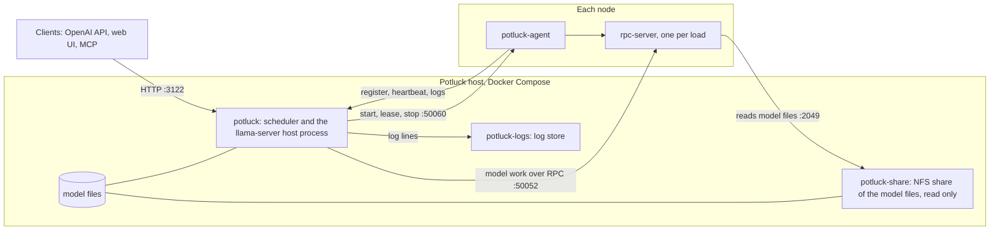

# Potluck

Potluck pools mixed Linux machines into one cluster that runs large language models behind an OpenAI-compatible API. Clients ask for a model by name. Potluck picks the machines, loads the model with llama.cpp, and forwards the request. A model too large for one machine is split across several.

The repository holds the scheduler (`llm-scheduler`), the node agent (`potluck-agent`), the web UI and the deployment files.

## How it fits together



- **Scheduler.** Takes requests, queues them, decides placement, starts one `llama-server` per loaded model inside its container, and keeps all configuration in a SQLite database.
- **Agents.** Each node runs `potluck-agent`. It registers, fetches the right llama.cpp programs from the scheduler, starts an `rpc-server` worker when a load needs the node, and reports memory and stats.
- **Share.** A read-only NFS export of the model folder, so workers can read model files themselves instead of receiving them over the network.
- **Log store.** VictoriaLogs. Potluck, its programs and every agent send their log lines there. Its search page is served by Potluck under `/logs/`.

[docs/architecture.md](docs/architecture.md) explains the parts and the flows.

## Before you start

- There is **no authentication**. Run Potluck on a network you trust.
- Nodes are Linux machines with AMD graphics (Vulkan) or Nvidia cards (CUDA).
- **Restarting the scheduler ends every loaded model.** The first request after a restart loads the model again.

## From nothing to a working pool

The examples use `192.0.2.1` for the Potluck host on the network the nodes use, and `192.0.2.0/24` for that network. Use your own addresses.

### 1. Prepare the host

You need:

- A Linux machine with Docker and the Compose plugin.
- An Nvidia GPU with the NVIDIA Container Toolkit. The compose file reserves the GPU for the scheduler, so its own card can serve models.
- The kernel modules `nfs` and `nfsd` loaded at boot (a file in `/etc/modules-load.d/` that lists them). The share container cannot load them itself.
- The model files (GGUF) in one folder, readable by everyone.
- A base image that contains `llama-server-rpc`: a `llama-server` built with RPC from the [llama.cpp fork](https://github.com/Jtonna/llama.cpp-for-datacenter-gpu-orchestrator). `deploy/rpc-build.Dockerfile` is the build recipe. The scheduler image is built on top of it (`BASE_IMAGE` below).

### 2. Build the scheduler image

From the repository root:

```sh
docker build -f deploy/Dockerfile -t llm-scheduler:local \
  --build-arg BASE_IMAGE=<your base image> \
  --build-arg VERSION="$(git describe --always --dirty)" .
docker run --rm --entrypoint llm-scheduler llm-scheduler:local --version
```

### 3. Install the deployment files

```sh
sudo mkdir -p /opt/potluck /srv/potluck
cp deploy/docker-compose.yml deploy/seed-config.yaml deploy/share-nfs.conf /opt/potluck/
```

Create `/opt/potluck/.env` with the share's address and network:

```sh
POTLUCK_SHARE_BIND=192.0.2.1
POTLUCK_SHARE_NET=192.0.2.0/24
```

Then edit two things in `/opt/potluck/docker-compose.yml`:

- `device:` of the `models` volume at the bottom: the folder that holds your model files.
- `0.0.0.0:3122` if Potluck should listen on one address only.

Everything Potluck stores goes under `/srv/potluck` (set `POTLUCK_ROOT` in `.env` to move it).

### 4. Put a program release in place

Agents fetch their programs from the scheduler. The scheduler serves exactly one release, the one it was built as (`0.1.9` today), from `/srv/potluck/programs/0.1.9/`:

- `release.json`: the release, the llama build commit and the platforms.
- `agent/`: `potluck-agent-linux-amd64` and `potluck-starter.sh`.
- One folder per platform, for example `linux-amd64-cuda/` and `linux-amd64-vulkan/`, with `llama-server` and `rpc-server` built from the fork commit named in `release.json`, plus the stats exporters.
- A `SHA256SUMS` file in every folder.

The layout and every rule are in [agent contract section 5.2](docs/agent-contract.md). Build the agent with:

```sh
CGO_ENABLED=0 GOOS=linux GOARCH=amd64 go build -o potluck-agent-linux-amd64 ./cmd/potluck-agent
```

The host's `llama-server-rpc` must be built from the same commit as the release's programs. Otherwise every load is refused.

### 5. Write the first configuration

Edit `/opt/potluck/seed-config.yaml`: at least `local_node` (a name for the host), `tiers` (how your machines are matched and ranked) and `profiles` (the models clients can ask for). Then check it and import it once:

```sh
cd /opt/potluck
docker compose run --rm --no-deps potluck import-config --check /seed/seed-config.yaml
docker compose run --rm --no-deps potluck import-config /seed/seed-config.yaml
```

From now on the configuration lives in the database. Change it in the web UI, over REST or with MCP. The seed file is not read again.

### 6. Start Potluck

```sh
docker compose up -d
curl -fsS http://127.0.0.1:3122/health
curl -s http://127.0.0.1:3122/api/system
```

In the `/api/system` answer, `programs.served` must be `true` and there must be no `host_build_error`.

### 7. Add a node

Copy `deploy/agent/potluck-agent-setup` to the node and run it as root. For a node with Docker (Nvidia cards):

```sh
sudo sh potluck-agent-setup --docker --potluck 192.0.2.1:3122 --model-source share:192.0.2.1:/
```

Use `--bare` instead of `--docker` to install the agent as a systemd service. A node that runs from RAM only uses `deploy/agent/potluck-starter.sh` at every boot instead. [deploy/agent/README.md](deploy/agent/README.md) lists the three paths.

The node must accept TCP `50060` and `50052` from the Potluck host. The script opens them when ufw is active. Check that the node joined:

```sh
curl -s http://127.0.0.1:3122/api/nodes
```

Its entry says `"state": "active"`. When it gets no load, `unplaced` says why ([runbook section D](docs/runbook.md)).

### 8. Load a model and send a request

```sh
curl -s -X POST http://127.0.0.1:3122/api/plan -d '{"model":"qwen3-4b"}'
curl -s -X POST http://127.0.0.1:3122/api/load -d '{"model":"qwen3-4b"}'
curl -s http://127.0.0.1:3122/v1/chat/completions -H 'Content-Type: application/json' \
  -d '{"model":"qwen3-4b","messages":[{"role":"user","content":"Say hello."}]}'
```

`/api/plan` says what would happen and changes nothing. `/api/load` is optional: the first chat request loads the model too.

### 9. Open the UI

The web UI is at `http://192.0.2.1:3122/ui/`. The log search page is at `http://192.0.2.1:3122/logs/`. AI agents connect over MCP at `http://192.0.2.1:3122/mcp`.

## Documents

- [docs/architecture.md](docs/architecture.md): the parts and how they work together.
- [docs/runbook.md](docs/runbook.md): running a deployment day to day, troubleshooting.
- [docs/benchmark-guide.md](docs/benchmark-guide.md): designing, running and reading benchmarks.
- [docs/agent-contract.md](docs/agent-contract.md): the wire contract between Potluck and `potluck-agent`.
- [docs/stats-contract.md](docs/stats-contract.md): the stats an agent reports.
- [docs/releases.md](docs/releases.md): what each release brings and what to do at a roll-out.
- [deploy/agent/README.md](deploy/agent/README.md): the node install, start and removal scripts.
- [configs/example.yaml](configs/example.yaml): every configuration field, in the import format.

## Development

```sh
go vet ./...
go test ./...
```

The tests use a fake `llama-server` and fake agents, so they need no GPU.

Try the web UI without a cluster:

```sh
go run ./cmd/devcluster --listen 127.0.0.1:8790 --scenario demo
```

It runs the real scheduler against simulated machines. The UI is at `http://127.0.0.1:8790/ui/`.

## Licence

MIT. See [LICENSE](LICENSE).
