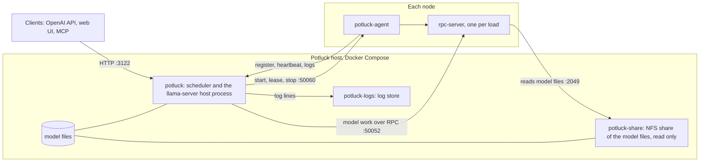

# Potluck

Potluck pools mixed Linux machines into one cluster that runs large language models behind an OpenAI-compatible API. Clients ask for a model by name. Potluck picks the machines, loads the model with llama.cpp, and forwards the request. A model too large for one machine is split across several.

The repository holds the scheduler (`llm-scheduler`), the node agent (`potluck-agent`), the web UI and the deployment files.

## How it fits together



- **Scheduler.** Takes requests, queues them, decides placement, starts one `llama-server` per loaded model inside its container, and keeps all configuration in a SQLite database.
- **Agents.** Each node runs `potluck-agent`. It registers, fetches the right llama.cpp programs from the scheduler, starts an `rpc-server` worker when a load needs the node, and reports memory and stats.
- **Share.** A read-only NFS export of the model folder, so workers can read model files themselves instead of receiving them over the network.
- **Log store.** VictoriaLogs. Potluck, its programs and every agent send their log lines there. Its search page is served by Potluck under `/logs/`.

[docs/architecture.md](docs/architecture.md) explains the parts and the flows.

## Before you start

- There is **no authentication**. Run Potluck on a network you trust.
- Nodes are Linux machines with AMD graphics (Vulkan) or Nvidia cards (CUDA).
- **Restarting the scheduler ends every loaded model.** The first request after a restart loads the model again.

## From nothing to a working pool

The examples use `192.0.2.1` for the Potluck host on the network the nodes use, and `192.0.2.0/24` for that network. Use your own addresses.

### 1. Prepare the host

You need:

- A Linux machine with Docker and the Compose plugin.
- An Nvidia GPU with the NVIDIA Container Toolkit. The compose file reserves the GPU for the scheduler, so its own card can serve models.
- The kernel modules `nfs` and `nfsd` loaded at boot (a file in `/etc/modules-load.d/` that lists them). The share container cannot load them itself.
- The model files (GGUF) in one folder, readable by everyone.
- A base image that contains `llama-server-rpc`: a `llama-server` built with RPC from the [llama.cpp fork](https://github.com/Jtonna/llama.cpp-for-datacenter-gpu-orchestrator). `deploy/rpc-build.Dockerfile` is the build recipe. The scheduler image is built on top of it (`BASE_IMAGE` below).

### 2. Build the scheduler image

From the repository root:

```sh
docker build -f deploy/Dockerfile -t llm-scheduler:local \
  --build-arg BASE_IMAGE=<your base image> \
  --build-arg VERSION="$(git describe --always --dirty)" .
docker run --rm --entrypoint llm-scheduler llm-scheduler:local --version
```

`BASE_IMAGE` has no default: a build without it stops in its first step with "BASE_IMAGE is required: pass --build-arg BASE_IMAGE=<image>". `deploy/rpc-build.Dockerfile` takes the same required argument (the image it adds `llama-server-rpc` to).

### 3. Install the deployment files

```sh
sudo mkdir -p /opt/potluck /srv/potluck
cp deploy/docker-compose.yml deploy/seed-config.yaml deploy/share-nfs.conf /opt/potluck/
```

Create `/opt/potluck/.env` with the share's address and network:

```sh
POTLUCK_SHARE_BIND=192.0.2.1
POTLUCK_SHARE_NET=192.0.2.0/24
```

Then edit two things in `/opt/potluck/docker-compose.yml`:

- `device:` of the `models` volume at the bottom: the folder that holds your model files.
- `0.0.0.0:3122` if Potluck should listen on one address only.

Everything Potluck stores goes under `/srv/potluck` (set `POTLUCK_ROOT` in `.env` to move it).

### 4. Put a program release in place

Agents fetch their programs from the scheduler. The scheduler serves exactly one release, the one it was built as (`0.1.10` today), from `/srv/potluck/programs/0.1.10/`:

- `release.json`: the release, the llama build commit and the platforms.
- `agent/`: `potluck-agent-linux-amd64` and `potluck-starter.sh`.
- One folder per platform, for example `linux-amd64-cuda/` and `linux-amd64-vulkan/`, with `llama-server` and `rpc-server` built from the fork commit named in `release.json`, plus the stats exporters.
- A `SHA256SUMS` file in every folder.

The layout and every rule are in [agent contract section 5.2](docs/agent-contract.md). Build the agent with:

```sh
CGO_ENABLED=0 GOOS=linux GOARCH=amd64 go build -o potluck-agent-linux-amd64 ./cmd/potluck-agent
```

The host's `llama-server-rpc` must be built from the same commit as the release's programs. Otherwise every load is refused.

### 5. Write the first configuration

Edit `/opt/potluck/seed-config.yaml`: at least `local_node` (a name for the host), `tiers` (how your machines are matched and ranked) and `profiles` (the models clients can ask for). Then check it and import it once:

```sh
cd /opt/potluck
docker compose run --rm --no-deps potluck import-config --check /seed/seed-config.yaml
docker compose run --rm --no-deps potluck import-config /seed/seed-config.yaml
```

From now on the configuration lives in the database. Change it in the web UI, over REST or with MCP. The seed file is not read again.

### 6. Start Potluck

```sh
docker compose up -d
curl -fsS http://127.0.0.1:3122/health
curl -s http://127.0.0.1:3122/api/system
```

In the `/api/system` answer, `programs.served` must be `true` and there must be no `host_build_error`.

### 7. Add a node

Copy `deploy/agent/potluck-agent-setup` to the node and run it as root. For a node with Docker (Nvidia cards):

```sh
sudo sh potluck-agent-setup --docker --potluck 192.0.2.1:3122 --model-source share:192.0.2.1:/
```

Use `--bare` instead of `--docker` to install the agent as a systemd service. A node that runs from RAM only uses `deploy/agent/potluck-starter.sh` at every boot instead. [deploy/agent/README.md](deploy/agent/README.md) lists the three paths.

The node must accept TCP `50060` and `50052` from the Potluck host. The script opens them when ufw is active. Check that the node joined:

```sh
curl -s http://127.0.0.1:3122/api/nodes
```

Its entry says `"state": "active"`. When it gets no load, `unplaced` says why ([runbook section D](docs/runbook.md)).

### 8. Load a model and send a request

```sh
curl -s -X POST http://127.0.0.1:3122/api/plan -d '{"model":"qwen3-4b"}'
curl -s -X POST http://127.0.0.1:3122/api/load -d '{"model":"qwen3-4b"}'
curl -s http://127.0.0.1:3122/v1/chat/completions -H 'Content-Type: application/json' \
  -d '{"model":"qwen3-4b","messages":[{"role":"user","content":"Say hello."}]}'
```

`/api/plan` says what would happen and changes nothing. `/api/load` is optional: the first chat request loads the model too.

### 9. Open the UI

The web UI is at `http://192.0.2.1:3122/ui/`. The log search page is at `http://192.0.2.1:3122/logs/`. AI agents connect over MCP at `http://192.0.2.1:3122/mcp`.

## Documents

- [docs/architecture.md](docs/architecture.md): the parts and how they work together.
- [docs/runbook.md](docs/runbook.md): running a deployment day to day, troubleshooting.
- [docs/benchmark-guide.md](docs/benchmark-guide.md): designing, running and reading benchmarks.
- [docs/agent-contract.md](docs/agent-contract.md): the wire contract between Potluck and `potluck-agent`.
- [docs/stats-contract.md](docs/stats-contract.md): the stats an agent reports.
- [docs/releases.md](docs/releases.md): what each release brings and what to do at a roll-out.
- [deploy/agent/README.md](deploy/agent/README.md): the node install, start and removal scripts.
- [configs/example.yaml](configs/example.yaml): every configuration field, in the import format.

## Development

```sh
go vet ./...
go test ./...
```

The tests use a fake `llama-server` and fake agents, so they need no GPU.

Try the web UI without a cluster:

```sh
go run ./cmd/devcluster --listen 127.0.0.1:8790 --scenario demo
```

It runs the real scheduler against simulated machines. The UI is at `http://127.0.0.1:8790/ui/`.

## How a release is judged

A candidate build replaces the live scheduler only after its tests and three programs have run on a **copy** of the live data folder. The programs make the copy themselves. Each database is copied with SQLite (`VACUUM INTO` from a read-only connection), so the copy is consistent even while the live scheduler writes the database. The programs live in this repository, so a gate can be run again from a clean clone at a commit. Nothing about one deployment is built in: the data folder, the models folder, the program release, the fake fleet and the builds are all flags. The examples use 192.0.2.x addresses and made-up names.

The first two programs are subcommands of `potluck-gate` (`cmd/potluck-gate`). A build is a binary, or `image:NAME` for an image run with `docker run --network host`. Each program copies `--data` (and `--history`, the event history folder, when given) into its own work folder and never writes the source.

1. **Readiness and crash test.** It loops configuration writes on one build while reader goroutines read the listings without a pause (`--readers`, by default three on `/api/profiles`, one on `/v1/models` and one on `/api/needs`). A cycle takes one gate profile from absent back to absent: create, change, delete. It kills the build at random moments within a write and starts it again.

   ```sh
   go build -o bin/potluck-gate ./cmd/potluck-gate
   bin/potluck-gate crash --scheduler image:potluck:candidate --data /srv/copy/data --models /srv/models \
       --programs /srv/programs --duration 5m --kills 40 --out gate/crash.json
   ```

   It passes when all of these hold:
   - every read answers 200 and parses, the readers' too;
   - every acknowledged write is stored whole, and a write cut by a kill is stored whole or not at all;
   - the configuration revision never goes back;
   - `/api/profiles`, `/api/config/profiles` and the model catalog list the same number of profiles;
   - the log has no panic and no `ERROR` line. `--allow-log` names an error the caller expects;
   - after the last stop, every database of the copy passes SQLite's integrity check.

   Output: one line with the cycles, the writes, the kills, the readers' reads by kind (`listings{list models needs}`), the bad reads, the bad writes and the listing counts, plus the JSON file. Exit 0 PASS, 1 FAIL.

   An earlier readiness test ran 40 seconds of create-and-delete pairs beside the same readers, with no kill and no read-back. `--duration 40s --change=false --kills 0 --verify cycle` runs the same cycles, so its figures compare with that test's.

2. **Plan rows of two builds.** OLD and NEW run, one after the other, on the same copy, each with the same fake fleet (`potluck-fake-agents --nodes FILE`, built from `cmd/potluck-fake-agents`; `nodes.sample.json` shows the format).

   ```sh
   bin/potluck-gate plans --old image:potluck:live --new image:potluck:candidate --data /srv/copy/data \
       --models /srv/models --programs /srv/programs --nodes gate/nodes.json --fake-agents bin/potluck-fake-agents --out gate/plans
   ```

   Each run dumps every profile's need and every field of its plan, including each node's memory row (`will_take_mib`, `basis`, `host_overhead_mib` and its source). It then runs OLD again on the data NEW touched, and NEW again: **the way back**. Both re-runs must match their first dumps. Each comparison prints the number of profiles whose plan differs and the rows (profile, field, old, new); `plans.json` has them all. Each run also gets one line: the build's version, the plan actions counted, the memory rows, that run's panic and `ERROR` lines, and, after its stop, the integrity check of each database with its need tables and migrations ledgers. The exit status is 0, unless `--fail-on` names what the caller expects: `old-new` (the builds plan alike), `way-back` (both re-runs equal) and `runs` (every run clean).

   The nodes file can mirror a running scheduler's fleet without its addresses: `potluck-fake-agents --from-status http://192.0.2.20:3122/api/nodes --print > gate/nodes.json`.

3. **Every page drawn.** `scripts/gate/pages.mjs` draws every route of the web UI of a running scheduler, at 1536 and 1280 px wide by default, as full-page PNGs. Start the candidate on a copy first. The harness never checks that the address is not live: pointing it at a copy is the caller's job.

   It sends no write. Every request that is not a GET is aborted in the browser; `--allow-post /api/plan` lets a named dry-run POST through. The routes come from three places:
   - every view of the UI: a list of its addresses, which a test checks against the views the UI registers;
   - the detail routes built from the API's answers. These are the first hand-made profile, model, deleted model and zone, and the first three groups. Of the runs, it takes the newest, a failed one, a group's, a direct benchmark's and a pinned or noted one, with their reports. No id is fixed in the script;
   - every link on a drawn page whose shape is new. A view of a page (`?show=`, `?tab=`) counts as a shape of its own.

   Pages are drawn in a light theme, with motion reduced and animations off, in en-US and UTC, so two runs give the same pictures.

   For each page it reports whether the page scrolls sideways, the squeezed texts, the overlapping texts, and the console errors. A text is squeezed when it is clipped (a clip with the full text in a `title` is counted apart). A long text is also squeezed when it wraps onto three lines or more in a box narrower than `--min-chars` characters. Screen-reader-only text is not judged.

   Two texts overlap when they sit in different cells of one row and are painted over each other: their visible line boxes intersect by more than 1 px both ways. A row is a table row, or an element laid out as a grid or as a flex row; its children are the cells. Each line box comes from `Range.getClientRects()` on the text node, so a text that runs out of its cell is measured where it is painted. The part an ancestor's overflow cuts off does not count. Text that is placed absolutely or fixed inside its cell (a badge, a tooltip, a menu), hidden for screen readers, or not shown is not judged. `--strict` fails on any of these findings. The rules are in `pages-lib.mjs`; `pages-fixture.test.mjs` checks the overlap rule in Chromium on a fixture page when Playwright is installed.

   ```sh
   cd scripts/gate && npm install && npx playwright install chromium
   node pages.mjs --base http://192.0.2.20:3122 --out ../../gate/pages
   ```

   Playwright is a dev dependency of `scripts/gate` alone, pinned in its `package.json`. It lives there beside the other UI scripts, and the scheduler itself does not use node. In the Playwright container image of the same version, no install is needed. On Git Bash for Windows, set `MSYS_NO_PATHCONV=1`, or `/api/plan` is rewritten to a Windows path.

The tests of the build come first, with `potluck-gate tests`. It runs `go test -json` in stages given by flags. It keeps every stage's whole output in `<out>/<stage>.log`, and it names each failing test (subtests too, with the log line where its output starts), each package that did not build, and each data race and panic with its test:

```sh
bin/potluck-gate tests --out gate/tests --stage "unit=-count=1 ./..." \
    --stage "race=-race -count=1 ./..." --env CGO_ENABLED=1
```

Each program has `--help` and a `--dry-run` that starts nothing. `go test ./cmd/potluck-gate` checks them all in about 30 seconds:
- the crash test and the plan comparison run against a fake build that loses writes or changes plans;
- the same two run against the real scheduler with a fake fleet;
- `tests` runs a small module with failing tests, a panic and a package that does not build;
- the harness's rules run under `node --test`.

## Licence

MIT. See [LICENSE](LICENSE).
