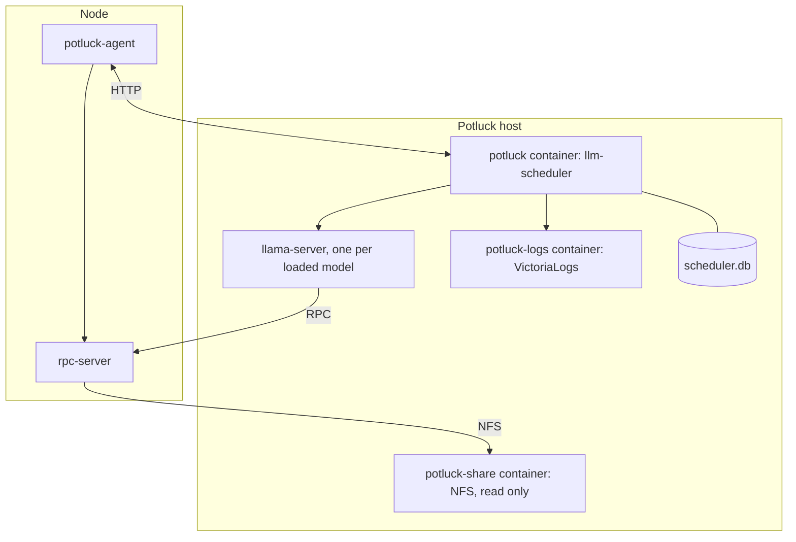
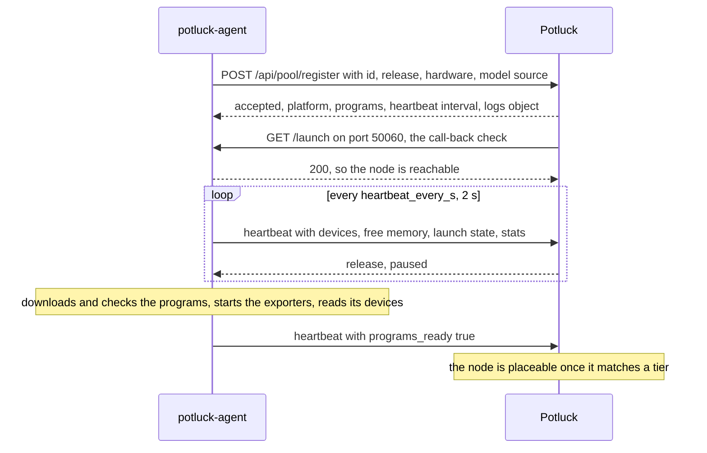
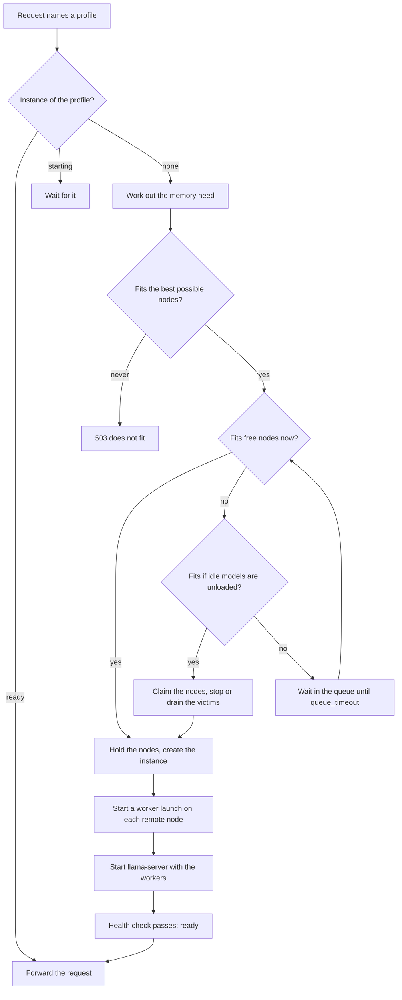
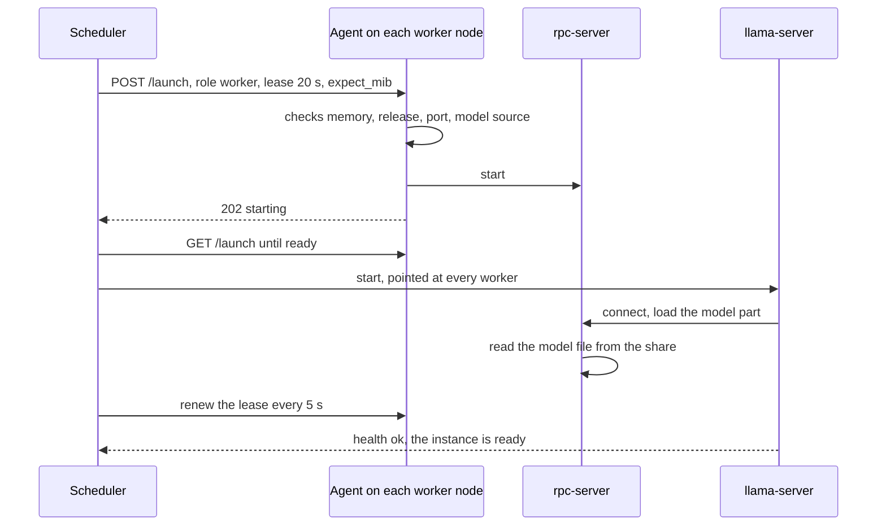
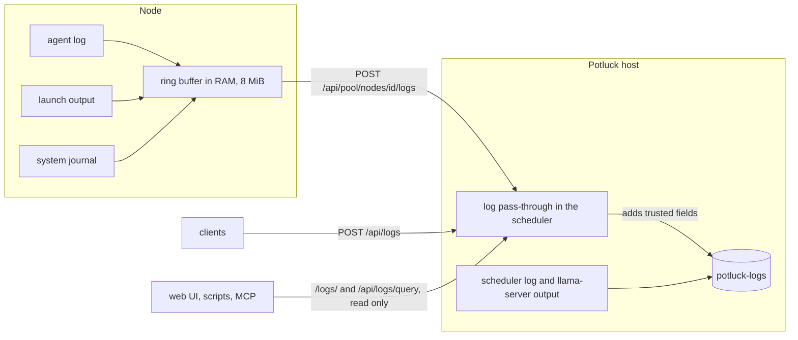
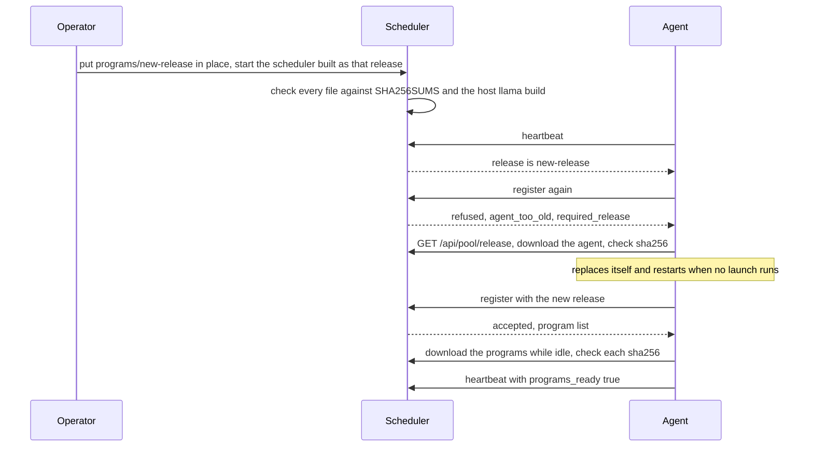

# Potluck architecture

This document explains the parts of Potluck and how they work together. The wire details are in the [agent contract](agent-contract.md) and the [stats contract](stats-contract.md). Operator steps are in the [runbook](runbook.md).

## 1. The parts

| Part | Where | Job |
|---|---|---|
| `llm-scheduler` | `potluck` container on the host | The API, the queue, placement, starting and stopping models, configuration, history, benchmarks, the web UI, the MCP server. One Go binary. |
| `llama-server` | Child processes of the scheduler | One per loaded model. It holds the model's first part on the host GPU (when placed there) and drives the remote workers over llama.cpp RPC. It answers the client requests the scheduler forwards. |
| `potluck-agent` | One per node | Registers the node, fetches programs, starts and stops the worker, enforces the lease and a memory watchdog, reports memory and stats, ships log lines. |
| `rpc-server` | Started by the agent, one per load | The worker. It serves one client at a time. It reads its part of the model from the share, or receives it over the RPC connection. |
| Share | `potluck-share` container | A read-only NFSv4 export of the model folder on port 2049, bound to the address the nodes use. A separate container, so a scheduler restart does not cut it. |
| Log store | `potluck-logs` container | Keeps log lines from everywhere. Its port is not published: only the scheduler reaches it. |

### Ports

| Port | Who listens | Who connects |
|---|---|---|
| 3122 | Scheduler (8080 inside the container) | Clients, the web UI, agents |
| 2049 | Share | Nodes that read model files from the share |
| 50060 | Agent API on each node | The scheduler |
| 50052 | `rpc-server` during a load | The load's `llama-server`: the scheduler's, or a host node's |
| 50061 | `llama-server` of a host launch on a node (release 0.1.9), only while it runs | The scheduler only; every route but `/health` wants the launch's per-launch key |

### Words

- **Profile**: a model a client can ask for: the model file, the context size and other settings. Clients use the profile name, for example `gemma-3-12b:32k`.
- **Node**: a machine in the pool. The host's own GPU is the **local node**.
- **Tier**: a rule that matches nodes and gives them a priority, the memory to keep free (headroom), the link speed and a settle time.
- **Instance**: one loaded profile: one `llama-server` and the nodes it holds. A node holds at most one instance, because a worker serves one client.
- **Launch**: one run of `rpc-server` (a worker launch) or `llama-server` (a host launch, release 0.1.9) on one node, from the start request to its exit.
- **Host**: the machine that runs a load's `llama-server`. The scheduler's own machine, unless the profile says `host: node`.
- **Release**: one version string that names the scheduler, the agent and the program set together.

## 2. Package map

| Package | Job |
|---|---|
| `cmd/llm-scheduler` | The scheduler binary: flags, wiring, signals, `import-config`. |
| `cmd/potluck-agent` | The agent binary. |
| `cmd/devcluster` | A development harness: the real scheduler against simulated nodes. |
| `internal/api` | HTTP routes: the OpenAI paths, llama-swap compatible paths, admin paths, the web UI files (`internal/api/ui`). |
| `internal/proxy` | Reads the model name from a request and streams the request to the instance. |
| `internal/scheduler` | The state machine: instances, the queue, claims, eviction, timers, failure rules. |
| `internal/placer` | Pure functions: place a model, plan an eviction, or say why neither works. |
| `internal/estimate`, `internal/gguf` | Read the model file header and estimate the memory need. |
| `internal/instance` | Builds the `llama-server` command line, starts, health-checks and stops one child, follows its load; `RemoteChild` stands for a host running on a node. |
| `internal/pool` | Agent membership: the registry of agents, the node view the scheduler reads, worker launches and host launches. |
| `internal/release` | Loads and verifies the program release handed out to agents. |
| `internal/needstore` | Keeps learned memory needs in the database across restarts. |
| `internal/startups` | Turns the agents' start-up reports into start-up figures per node. |
| `internal/config`, `internal/cfgstore`, `internal/cfgsvc`, `internal/audit` | The configuration document and its schema, revisions and the audit log in SQLite, and the one service every change goes through. |
| `internal/history` | The event history: JSON Lines files on disk, the newest events in memory. |
| `internal/availability` | The availability sampler: each machine's state every 10 s, seconds per state per hour into `usage.db`, read back as hour or day cells. |
| `internal/bench`, `internal/benchspec` | Benchmarks: definitions, the runner, the store, statistics, exports. |
| `internal/logrelay`, `internal/selflog` | Central logging: the pass-through to the log store, and the shipper for the scheduler's own lines. |
| `internal/mcpserver` | The MCP server at `/mcp`. Each tool runs the matching REST request in process. |
| `internal/fleet` | Legacy fleet membership (section 9), and the local GPU probe. |
| `internal/agentproto` | The wire types of the agent and stats contracts. |
| `internal/agent/...` | The agent's parts: identity, hardware, programs, launches, the model source, stats, log shipping, start-up report. |
| `internal/testutil`, `internal/e2e` | Fake `llama-server`, fake agents, end-to-end tests. |

### Inside the scheduler

All scheduler state belongs to one goroutine. It takes events from a channel: a request arrived or finished, a client left, a child became healthy or exited, a node changed, a timer fired, an admin command. HTTP handlers only send events and wait for the answer. Slow work (starting and stopping processes, talking to agents) runs outside and reports back as events. The clock, the node view and the launcher are interfaces, so every rule is tested with fakes.

## 3. Configuration and data

Configuration lives in `scheduler.db`, not in a file: profiles, tiers, node lists, settings, benchmarks. Every change is a numbered revision with an audit entry that records who changed what and from where (web UI, REST, MCP, import). Changes apply at once, except the few settings the schema marks `restart_required`. A first install imports a YAML file once (`import-config`).

Six values are set outside the database, by flag or environment variable, because they are deployment paths: `--listen`, `--data-dir`, `--models-dir`, `--history-dir`, `--child-log-dir` and `--programs-dir` (`LLM_SCHEDULER_LISTEN`, `_DATA_DIR`, `_MODELS_DIR`, `_HISTORY_DIR`, `_CHILD_LOG_DIR`, `_PROGRAMS_DIR`). The log store address is `LLM_SCHEDULER_LOGS_STORE_URL`.

What the deployment keeps under `POTLUCK_ROOT` (default `/srv/potluck`):

| Folder | Holds |
|---|---|
| `data/` | `scheduler.db`: configuration, revisions, audit log, benchmarks and runs, learned memory needs, node pause and removal. `usage.db`: the request log and its hourly and daily totals (section 3.1) |
| `history/` | The event history, JSON Lines |
| `child-logs/` | The full output of every `llama-server` and a copy of every worker launch log |
| `programs/` | The program releases handed out to agents |
| `logs-store/` | The log store's data |

### 3.1 The usage file

`usage.db` (package `internal/usage`) is a second SQLite file beside `scheduler.db`, with its own schema version table (`usage_migrations`). It holds the request log (`client_requests`, one row per `/v1` and `/upstream` request) and its totals per hour (`request_hours`) and per day (`request_days`), by profile, counted in the UTC hour and day the request arrived. It is optional in every sense:

- An older image ignores it. A newer schema version is left untouched and the request log stays off.
- When it opens, a quick integrity check runs. A file that fails it, or cannot be opened, is renamed `usage.db.damaged-<UTC time>` (with its `-wal` and `-shm`) and an empty file takes its place; one WARN, and `history_begins_at` says from when the history is complete. A data folder that cannot be used leaves the request log off. None of this makes the scheduler unhealthy.
- Nothing writes to it on a request's path or in the core loop. The `/v1` and `/upstream` handlers tell the recorder what happened (arrived, admitted with the instance's machines and roles, ended with its figures); the recorder keeps queued and running requests in memory and queues each change for one writer goroutine (supervised, `usage.writer`), which writes in batches of up to 256 per transaction. The queue holds 4096 changes; when full it drops the oldest non-final update (the final row always carries everything), counted in `/api/system` `storage.usage.dropped`. Shutdown waits up to 10 s for the queue.
- Live rows (queued, running) are never written per token: the list merges memory and the file, and a running row's tokens out are the streamed chunks so far, replaced by the server's figure at the end. Rows a stopped process left open are closed as `failed`, `scheduler_restart`, at the next start.
- Retention (task `usage.retention`, an hour after another, deleting 500 rows per transaction): rows after `usage_request_days` (90), hourly totals after `usage_hourly_days` (396); daily totals stay.

## 4. How a node joins

The node id is the MAC address of the network interface that leads to Potluck, computed at every start. The agent sends its release; Potluck accepts only its own release, or refuses with a reason (`agent_too_old`, `potluck_too_old`, `unsupported_hardware`, `duplicate_id`, `foreign_process`, `removed`, `release_unavailable`).

Registration proves only that the node reaches Potluck. So Potluck calls the agent back once. Until that works, the node is listed with `unplaced: agent_unreachable`, usually because a firewall on the node drops port 50060.

A node that is registered but cannot take a load yet is listed with the reason in `unplaced`: programs not ready, model source unreachable, no matching tier, paused, and others. A request that needs it waits in the queue. Placement uses the node's free device memory as its own llama program reports it. For a device that shares system memory, the usable figure is also capped by the node's available memory minus the watchdog floor.

## 5. How a load is placed and launched

**Need.** A profile's memory need is its `needs_mib` when set, else an estimate from the model file (weights plus the KV cache of the layers that keep one, with a margin), plus, on every device of the placement, `device_overhead_mib` and a compute buffer that grows with the context (4 KiB per context token, measured). After a load with the same settings succeeds, the measured figure is learned: it replaces the estimate, and replaces `needs_mib` when it is larger. Models with sliding-window attention need a measured `needs_mib`: the estimate is several times too high for them.

**Reserve.** Before a load, what each node will take is worked out assuming the context is filled completely: the need share (weights plus context) and a fill reserve of `fill_reserve_kib_per_token` x the context per node, or, when it is higher, the most a node gave up for the profile in its latest normal load-to-unload cycle (the stored peak: it raises the figure, never lowers it). With `placement_uses_reserved`, a node counts as having the smaller of its latest and its average free memory (`free_average_window`), less what is reserved there and not measured yet; the per-node margin is `margin_measured_mib` or `margin_estimated_percent` when set, else the split skew margin. With any reservation setting on, every placement is held to that calculation, and no budget is ever above the one the default rules give. `POST /api/plan` shows the whole calculation per node in its `memory` section, for a profile that is not loaded too; its `fits` is the decision. The defaults keep the placement described here.

**Placement.** Tiers are tried in priority order. The placer takes one node if one fits, else the fewest nodes up to `max_pool`. A profile with `force_nodes` uses exactly those nodes. On shared-memory nodes a split model must fit each node's share with a skew margin, because the split never lands evenly. `exclude_nodes` keeps nodes out completely; `no_auto_nodes` keeps them for forced profiles only. A profile that forces an excluded node stays valid configuration: a write that creates the combination returns it as a warning, and the profile is refused at run time (reason `node excluded`, naming the `exclude_nodes` entry) until the exclusion is lifted.

**A node for command profiles only.** A node in `no_auto_nodes` that no llama profile forces takes command profiles only (for example speech-to-text), because a command profile runs on the local node and `no_auto_nodes` does not apply to it. That is how to configure a server that should only run such services: put it in `no_auto_nodes` and name it in no llama profile's `force_nodes`. There is no separate setting for it.

**Queue and eviction.** Each profile has at most one queue entry. When nothing fits, the scheduler plans an eviction: it claims nodes and stops idle models on them, or lets busy ones drain first. A model that just loaded is protected for about as long as it took to load (`min_hold` to `max_hold`). A running generation is never cut off by scheduling. An idle model unloads after `ttl`.

**Launch.**

The agent refuses a launch that would not fit its memory (`would_not_fit`), so a bad estimate cannot freeze a machine. While the launch runs, the agent's watchdog kills it when available memory falls below its floor. A launch whose lease is not renewed for 20 s is stopped by the agent itself, so a node never keeps a worker for a scheduler that is gone.

**A console as host (release 0.1.9).** A profile with `host: node` and `force_nodes` runs its `llama-server` on the first forced node instead of the scheduler's machine. The scheduler never picks a host by itself. The worker launches start first, on the other forced nodes; then the scheduler sends that node's agent a host launch (`role: host`, agent contract 6.15) with the workers' addresses, the split (host first), `expect_mib` (its device share plus `host_overhead_mib`), the file-load mode and a new random key. The agent starts `llama-server` on port 50061 with the key in a RAM file (`--api-key-file`). The scheduler checks `/health` from its own side, then forwards requests to the node with `Authorization: Bearer <key>`. The host is the instance's child as on the scheduler's machine (`instance.RemoteChild`, driven by the pool from the agent's reports), so the queue, eviction, leases, failures and history are the same. Only an agent that advertises `host_launch` is asked; the scheduler's own machine cannot be a device of a node host. Learned needs of such loads are kept under a shape of their own. `host_no_mmap` (default off) makes the host load without mmap, which also gives read progress.

**Failures.** A worker that exits, a load timeout, or a load that stops making progress (`load_stall_timeout`) fails the load. Waiting clients get `502` with the reason, and the profile is backed off for a while. A node that sends no heartbeat is lost after 10 s (20 s while it runs a launch); its instance is ended and the other members are stopped. A worker that ends for lack of memory raises the profile's learned need.

**Ready.** When `llama-server` answers its health check, the instance is ready and the waiting requests are forwarded. When the instance is gone, the scheduler stops the worker launches.

## 6. How logs travel

The registration answer tells each agent where and how to push its lines (the `logs` object). The agent copies lines into a ring in RAM and one background sender drains it. Nothing on the node waits for a log line: when the store is slow, the oldest lines are dropped and the next batch says how many.

The scheduler adds the fields that say who sent a line (node, platform, release, source, launch, profile), so a node cannot write under another node's name. The body is streamed through without being decoded. The log routes have their own limits and never share a lock with scheduling, so a log flood cannot slow a heartbeat or a request. The scheduler's own lines and its children's output go to the store the same way, through a ring that drops the oldest lines.

Every line has a `source`: `scheduler`, `host` (a `llama-server`), `agent`, `launch`, `journal` or `client`. The files stay where they were (child logs, launch logs, `docker logs`); the store is a copy. Readers get read-only access: the store's search page under `/logs/` and `GET /api/logs/query`. Central logging can be turned off with the `logs_enabled` setting, or for good by removing the store address.

## 7. How a release reaches the nodes

The scheduler serves one release at a time, and agents must run exactly that release. At start it hashes every file of `programs/<release>/` and refuses to serve the release when a file is missing or wrong. It also checks that its own `llama-server` was built from the llama commit the release names, because host and workers must come from the same build. When a check fails, agents are refused with `release_unavailable` and every load is refused.

How the agent updates itself depends on the install:

| Install | First agent | Update |
|---|---|---|
| Bare metal | `potluck-agent-setup --bare` | Downloads the new binary, checks it, replaces itself, restarts |
| RAM only | `potluck-starter.sh` at every boot | Downloads the new binary into RAM and restarts its unit |
| Docker | `potluck-agent-setup --docker` | Exits with code 75. Running the setup script again, or pulling the new image tag, replaces the container |

An agent never updates while a launch runs.

## 8. What restarts when

| What restarts | What happens |
|---|---|
| Scheduler (container restart or new image) | Every loaded model ends, a model hosted on a node too: its host launch is stopped like any other launch the new run does not hold. Each agent's next heartbeat gets `410`; it registers again with its launch, and the scheduler tells it to stop that launch. Configuration, pauses and learned memory needs come back from the database; the newest history events are reloaded. The queue, backoffs and quarantines start empty. Models load again on the next request. A benchmark run that was running is marked failed. |
| Share | Nodes' reads stand still for about 16 s (the NFS grace time is set to 10 s) and then resume. Their mounts are `hard`, so reads wait instead of failing. The scheduler and loaded models keep running. |
| Log store | Nothing changes for scheduling. Senders get `503` and keep their lines in their rings until the store is back; the oldest lines go first when a ring is full. |
| Agent, bare-metal install | The launch is its own systemd unit and keeps running. The restarted agent finds it again and continues its lease from a file. The node counts as silent, not lost, for up to 20 s. |
| Agent, Docker install | The launch runs inside the agent's container and ends with it. The instance fails with `agent_restarted`; the next request loads the model again. |
| Node (reboot) | The launch ends. The node is lost after 20 s without a heartbeat; its instance ends and the other members are stopped. At boot the agent starts again (systemd unit, Docker restart policy, or the starter), registers, and fetches its programs again if they were in RAM. Its start-up time is recorded. |
| Host (reboot) | The three containers come back by themselves (`restart: unless-stopped`) when Docker starts at boot and the NFS modules load. Agents keep retrying and register again. As with a scheduler restart, nothing is loaded until a request asks for it. |

A planned node restart can be announced (`POST /api/nodes/{id}/expect-restart`) so that it is measured and not reported as a lost node.

### Inside the scheduler: a background task fails

Every goroutine the scheduler starts runs under `internal/supervise` (a source scan in its tests fails on a bare `go` statement that is not allowlisted with a reason). A failure (a Go panic) in one of them is logged at error level with its stack, recorded as an `internalFailure` history event, counted, and listed in `GET /api/system` under `tasks`. HTTP handler panics are logged and counted the same way and are still answered by `net/http`. What happens next depends on the task:

| Kind | Tasks | After a failure |
|---|---|---|
| Restarts alone | WebSocket status and ping loops, fleet feed and probe, needs writer, background build reads, log relay watch, self-log check, log shipper | Restarts after a backoff (100 ms, 1 s, 5 s, doubling to 30 s; back to the start after a minute without a failure). |
| Rebuilds, then restarts | catalog (built again from scratch), SSE hub (drops its streams; browsers reconnect to a fresh snapshot), benchmark manager (fails the run in hand; its models are unloaded on the way out), history writer (continues in a fresh file), a launch's supervisor (`pool.launch`) and a host launch's supervisor (`pool.host_launch`, a model hosted on a node): each renews the lease and reads the launch state at once | As above, after the rebuild. |
| One-shot work | probes, starts, health waits, worker launches and stops, the stops of a model hosted on a node (`instance.remote_stop`: a stop that fails is reported and the kill after it still runs), reaping a model process, the audit writer, a cache eviction, a proxy prefetch, the watch that cuts a forwarded request when its model hosted on a node goes (`proxy.gone_watch`), a benchmark step | The failure becomes the work's result (an error the waiting side sees), so nothing waits forever. |
| Read-only queries | the scheduler's plan, status and needs queries (task `scheduler.read`, run inside the event loop) | The query answers 500 and the loop goes on; counted in `GET /api/system` as `read_panics` too. Never toward the stop below: it changed nothing. |
| Stops Potluck | the scheduler event loop, the pool's lost-node check, applying a configuration change | Their state cannot be rebuilt in place: see below. |

**A failure inside a lock stops Potluck, whatever the task.** The table's policies hold for a failure outside any lock section: the shared state is only written under its lock, so it cannot be half-written there. Every lock in the scheduler is released by a deferred call (a second source scan fails on one that is not), so a failure never leaves a lock held and Potluck never hangs where it used to crash. In the packages whose state a restarted task cannot rebuild (pool, scheduler, learned needs, history, model processes, configuration service, benchmarks) the release is `supervise.Unlocked`: a failure inside the section releases the lock and stops Potluck the bounded way below, since the state may be half-written. Per task, therefore:

| Task | Touches under a lock | Outside a section | Inside a section |
|---|---|---|---|
| scheduler event loop, pool lost-node check, configuration apply | scheduler, pool, configuration | stops Potluck | stops Potluck |
| needs writer | scheduler (its queue) | restarts | stops Potluck |
| history writer | history store | rebuilds (fresh file), restarts | stops Potluck |
| benchmark manager | benchmark run and store | fails the run, restarts | stops Potluck |
| a launch's supervisor, a host launch's supervisor, worker launches and stops, forced-stop reset | pool (`p.mu`, the launch's `l.mu`) | restarts, or the failure is the work's result | stops Potluck |
| reaping a model process, starts, health waits, probes, the stops of a model hosted on a node | model processes (a node-hosted model's child: its `mu` and output lock), scheduler | the failure is the work's result | stops Potluck |
| catalog, SSE hub, WebSocket loops, fleet feed, log relay, self-log, log shipper, audit writer, cache eviction, prefetch | their own state only (plain deferred release) | as in the table above | as outside: the state is the task's own and is rebuilt |

The members of one fan-out (the probes of one pre-flight, the launches or stops of one load, the members of a benchmark group, the nodes of one cache eviction) count as one failure toward the limit below. A failure while Potluck is already stopping on a signal is recorded (exit code 3) but does not shorten the shutdown's grace.

The same task failing a third time within 60 s also stops Potluck. The stop is bounded: Potluck logs the reason, records a `schedulerStopping` event, lets requests in flight answer for up to a second, kills every model process it started, and exits with code 3 within 5 s. The container's restart policy starts it again, as after any scheduler restart (table above). A configuration change whose apply failed is already saved: the request answers 500 and the restart applies it from the database.

## 9. Legacy: fleet membership

The setting `membership` can also be `fleet`, which is still the built-in default when a configuration does not set it (the shipped seed sets `agents`). In fleet mode the scheduler reads its nodes from an external fleet console (`fleet.url`) instead of agent registrations, probes each worker with `llama-server --list-devices` before a load, and can send recovery requests for a hung worker through that console. Nodes then run a long-lived `rpc-server` of their own. This mode is kept until a later release removes it; new deployments use agents.
